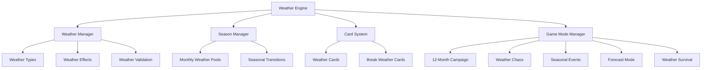

# Weather Engine Design Document

## Overview

The Weather Engine is a comprehensive system that manages weather effects, seasonal changes, and weather-based gameplay mechanics for a turn-based game. The system is designed to be modular, configurable, and extensible, supporting multiple game modes while maintaining realistic weather patterns and strategic depth.

## Architecture

### Core Components



### System Flow

1. **Initialization**: Load weather configurations and game mode settings
2. **Turn Processing**: Determine weather based on current month/mode rules
3. **Card Processing**: Handle weather card plays and validation
4. **Effect Calculation**: Apply weather modifiers to elemental damage
5. **State Management**: Update and persist weather state between turns

## Components and Interfaces

### Weather Types and Effects

```typescript
export type WeatherType =
  | "Sunny"
  | "Cloudy"
  | "Rainy"
  | "Windy"
  | "Stormy"
  | "Foggy"
  | "Snowy"
  | "Hot"
  | "Cold"
  | "Warm"
  | "Cool"
  | "Humid";

export type ElementType = "Fire" | "Ice" | "Lightning";

export interface WeatherEffect {
  [key: ElementType]: number; // Modifier value (-40 to +40)
}

export interface WeatherState {
  currentWeather: WeatherType[];
  turn: number;
  month: number;
  season: SeasonType;
  activeCards: WeatherCard[];
}
```

### Weather Manager

```typescript
export class WeatherManager {
  private weatherEffects: Map<WeatherType, WeatherEffect>;
  private compatibilityMatrix: Map<WeatherType, WeatherType[]>;
  private currentState: WeatherState;

  // Core weather operations
  public applyWeather(weather: WeatherType[]): void;
  public validateWeatherMix(weather: WeatherType[]): boolean;
  public calculateElementalModifiers(): Record<ElementType, number>;
  public resetWeather(): void;

  // Weather mixing and validation
  private checkOpposites(weather: WeatherType[]): boolean;
  private validateCompatibility(weather: WeatherType[]): boolean;
}
```

### Season Manager

```typescript
export type SeasonType = "Spring" | "Summer" | "Autumn" | "Winter";

export class SeasonManager {
  private monthlyWeatherPools: Map<number, WeatherPool>;
  private seasonalTransitions: Map<SeasonType, WeatherType[]>;

  public getWeatherForMonth(month: number): WeatherType;
  public getSeasonForMonth(month: number): SeasonType;
  public getWeatherPool(season: SeasonType): WeatherType[];

  // Weighted random selection based on season
  private selectWeatherByProbability(pool: WeatherPool): WeatherType;
}

interface WeatherPool {
  weights: Map<WeatherType, number>;
  totalWeight: number;
}
```

### Card System

```typescript
export type CardType =
  | "Weather"
  | "BreakWeather"
  | "WeatherBuff"
  | "WeatherNerf";

export interface WeatherCard {
  id: string;
  type: CardType;
  name: string;
  description: string;
  weather?: WeatherType;
  effect?: Partial<Record<ElementType, number>>;
  duration?: number;
  cost?: number;
}

export class WeatherCardManager {
  private activeCards: WeatherCard[];

  public playCard(
    card: WeatherCard,
    currentWeather: WeatherType[]
  ): WeatherType[];
  public validateCardPlay(card: WeatherCard): boolean;
  public processCardEffects(): Record<ElementType, number>;
  public expireCards(): void;
}
```

### Game Mode System

```typescript
export interface GameMode {
  name: string;
  description: string;
  weatherRules: WeatherRules;
  turnLimit: number;
  specialRules?: SpecialRule[];
}

export interface WeatherRules {
  weatherChangeFrequency: number; // Every N turns
  allowPlayerWeatherControl: boolean;
  allowWeatherMixing: boolean;
  maxWeatherTypes: number;
  weatherSource: "seasonal" | "random" | "predetermined" | "player-controlled";
}

export class GameModeManager {
  private availableModes: Map<string, GameMode>;
  private currentMode: GameMode;

  public setGameMode(modeName: string): void;
  public processWeatherForTurn(turn: number): WeatherType[];
  public validateModeRules(action: GameAction): boolean;
}
```

## Data Models

### Weather Configuration

```typescript
export interface WeatherConfig {
  weatherEffects: Record<WeatherType, WeatherEffect>;
  compatibilityMatrix: Record<WeatherType, WeatherType[]>;
  seasonalPools: Record<SeasonType, WeatherPool>;
  monthlyMappings: Record<number, SeasonType>;
  oppositeWeatherPairs: [WeatherType, WeatherType][];
  effectLimits: {
    min: number; // -40
    max: number; // +40
  };
}
```

### Game State

```typescript
export interface GameState {
  currentTurn: number;
  currentMonth: number;
  weatherState: WeatherState;
  playerStates: PlayerState[];
  gameMode: string;
  turnHistory: TurnRecord[];
}

export interface PlayerState {
  playerId: string;
  hand: WeatherCard[];
  playedCards: WeatherCard[];
  elementalAffinities: Record<ElementType, number>;
}
```

## Error Handling

### Weather Validation Errors

```typescript
export class WeatherValidationError extends Error {
  constructor(
    public readonly invalidWeather: WeatherType[],
    public readonly reason: string
  ) {
    super(`Invalid weather combination: ${reason}`);
  }
}

export class CardPlayError extends Error {
  constructor(
    public readonly card: WeatherCard,
    public readonly reason: string
  ) {
    super(`Cannot play card ${card.name}: ${reason}`);
  }
}
```

### Error Handling Strategy

1. **Validation Errors**: Prevent invalid weather combinations and card plays
2. **Configuration Errors**: Validate weather configs on load with detailed error messages
3. **State Errors**: Handle corrupted game state with recovery mechanisms
4. **Graceful Degradation**: Fall back to default weather when errors occur

## Testing Strategy

### Unit Testing

1. **Weather Manager Tests**

   - Weather effect calculations
   - Weather mixing validation
   - Compatibility matrix logic
   - Effect limit enforcement

2. **Season Manager Tests**

   - Monthly weather selection
   - Seasonal probability distributions
   - Weather pool management

3. **Card System Tests**
   - Card play validation
   - Effect application and duration
   - Card interaction edge cases

### Integration Testing

1. **Game Mode Integration**

   - Weather changes across different modes
   - Mode-specific rule enforcement
   - Turn progression and weather updates

2. **Full Game Flow Testing**
   - Complete 12-turn game simulation
   - Weather card interactions during gameplay
   - State persistence and recovery

### Performance Testing

1. **Weather Calculation Performance**
   - Large weather combination calculations
   - Frequent weather changes
   - Memory usage with extended gameplay

## Configuration and Extensibility

### Weather Configuration Files

```typescript
// weather-config.json
{
  "weatherEffects": {
    "Sunny": { "Fire": 20, "Ice": -10, "Lightning": -10 },
    "Rainy": { "Fire": -20, "Ice": 10, "Lightning": 10 }
    // ... other weather types
  },
  "seasonalPools": {
    "Winter": {
      "Cold": 0.25,
      "Snowy": 0.25,
      "Foggy": 0.15,
      "Windy": 0.15,
      "Cloudy": 0.10,
      "Stormy": 0.10
    }
    // ... other seasons
  }
}
```

### Extension Points

1. **Custom Weather Types**: Add new weather types with custom effects
2. **Custom Game Modes**: Define new modes with unique weather rules
3. **Custom Cards**: Create weather cards with special effects
4. **Event System**: Hook into weather changes for custom game events

### Localization Support

```typescript
export interface WeatherLocalization {
  weatherNames: Record<WeatherType, string>;
  weatherDescriptions: Record<WeatherType, string>;
  cardNames: Record<string, string>;
  modeNames: Record<string, string>;
}
```

## Performance Considerations

### Optimization Strategies

1. **Caching**: Cache weather effect calculations for repeated combinations
2. **Lazy Loading**: Load weather configurations only when needed
3. **Memory Management**: Efficient storage of weather history and card states
4. **Batch Processing**: Group weather calculations for multiple players

### Scalability

1. **Modular Design**: Each component can be scaled independently
2. **Configuration-Driven**: Reduce code changes for balance updates
3. **Event-Driven Architecture**: Loose coupling between weather system and game logic

## Security and Validation

### Input Validation

1. **Weather Type Validation**: Ensure only valid weather types are processed
2. **Card Validation**: Verify card authenticity and play legality
3. **State Validation**: Check game state integrity before processing

### Anti-Cheat Measures

1. **Server-Side Validation**: All weather changes validated on server
2. **Deterministic Random**: Use seeded random for reproducible weather patterns
3. **State Verification**: Regular game state checksums to detect tampering
